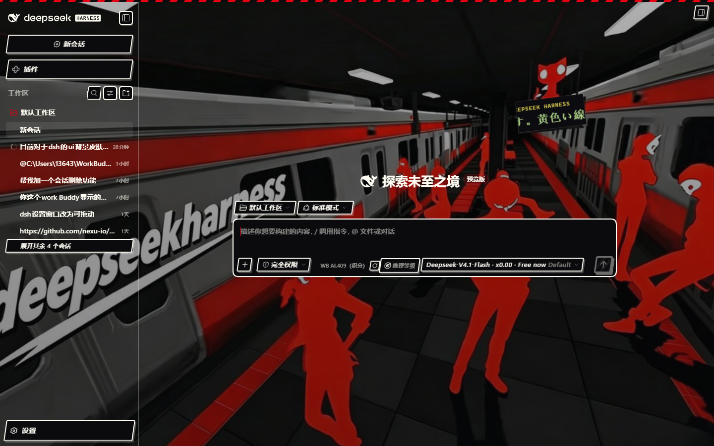
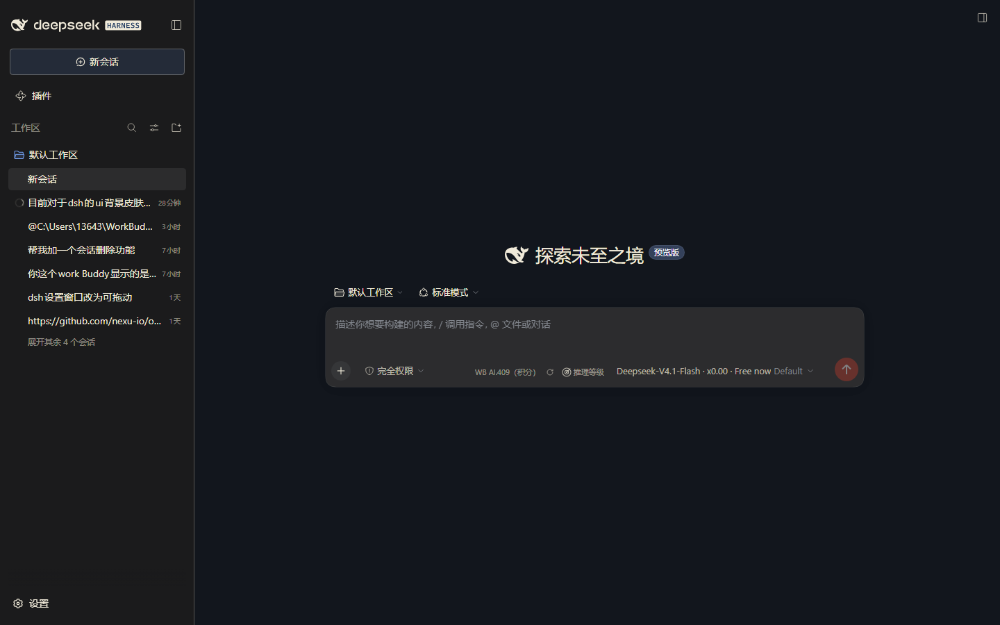
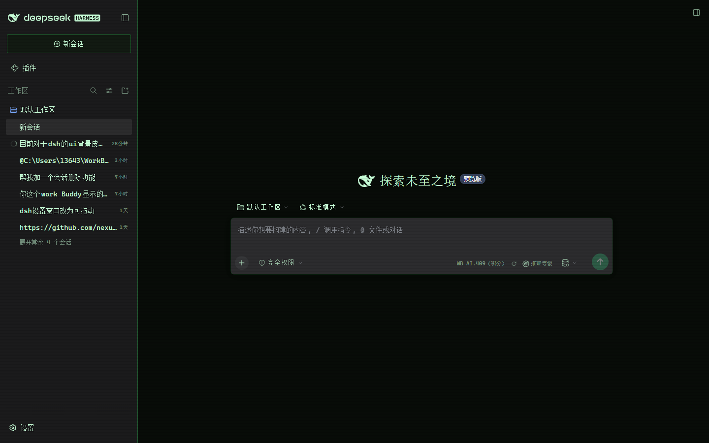
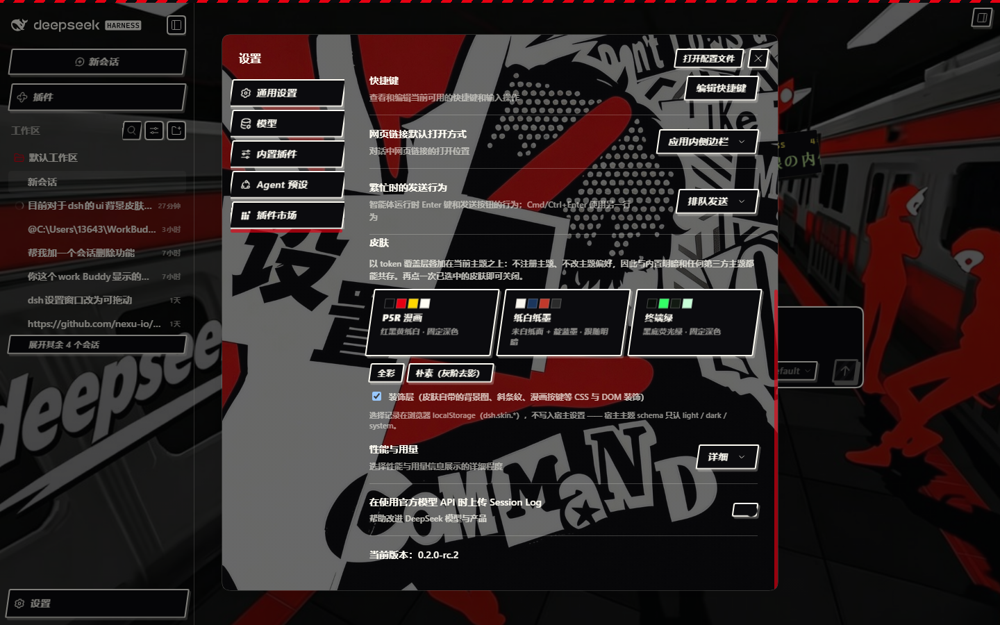

# dsh-skin-kit

给 [DeepSeek Harness](https://github.com/deepseek-ai) 桌面 / 网页客户端换肤的**皮肤引擎**。

不是「一个皮肤」，而是一套**可插拔的皮肤框架**：引擎负责叠层、持久化、设置界面，
皮肤本身只是一份纯数据声明（token 表 + 装饰 CSS/DOM）。想加自己的皮，写一个文件即可。



| 纸白纸墨（跟随明暗） | 终端绿（固定深色） |
|---|---|
|  |  |

内置三个皮肤：**P5R 漫画**（红黑黄纸白 + 日式车站动态背景）、**纸白纸墨**（明暗自适应）、
**终端绿**（黑底荧光绿 + 扫描线）。三个都在 **设置 → 通用设置 → 皮肤** 里一键切换。



## 核心机制：为什么是 overrideTokens 而不是注册主题

DSH 官方主题接口提供两条路，本插件走后者：

| 方式 | 行为 | 问题 |
|---|---|---|
| `theme.register()` + `theme.setTheme()` | 注册一个**独立主题**，出现在主题列表里 | 要抢占 `preference`。实测已装的 `dsh-catppuccin` 会在 `theme/change` 里把 preference 抢回它自己的 flavor，导致刚设的皮肤**立刻被顶掉** |
| `theme.overrideTokens(source, tokens)` ← **本插件** | 叠一层 token 覆盖在**当前激活主题之上**，不改 preference | 无。层按 seq 叠加、后叠者胜，不参与 preference 争夺 |

副作用是好处：本插件与内置明 / 暗、以及**任何第三方主题**都能共存——
你可以一边用 catppuccin 的配色，一边叠本插件的皮肤层。

每个 token 给的是 `{ light, dark }` 一对值，由当前主题的 `colorScheme` 决定用哪一侧。
皮肤想「固定深色」就把两臂填成同色（引擎也接受裸字符串，自动包成对）。

## 安装

插件目录放哪都行，关键是 profile 里用**目录联接**指向源码（pnpm 对 `file:` 是**拷贝**
语义，不重装不会刷新）：

```powershell
# 1) 取代码
git clone https://github.com/<你>/dsh-skin-kit.git "$env:USERPROFILE\.dsh\local-plugins\dsh-skin-kit"

# 2) 在 profile 里建目录联接
cmd /c mklink /J "$env:USERPROFILE\.dsh\profiles\desktop\node_modules\dsh-skin-kit" `
                "$env:USERPROFILE\.dsh\local-plugins\dsh-skin-kit"
```

再在 profile 的 `package.json` 里登记两处：

```json
{
  "dependencies": {
    "dsh-skin-kit": "file:C:/Users/<你>/.dsh/local-plugins/dsh-skin-kit"
  },
  "dsh": {
    "profile": {
      "bundles": ["...", "dsh-skin-kit"]
    }
  }
}
```

配置改动**热生效**（`dsh-hmr` 盯着 profile 的 `package.json`），加插件行不需要重启 DSH。
但改 `client.js` 的**代码**需要刷新页面。

> 仓库里已经带了构建好的 `client.js`，克隆下来即可用，不必跑构建。
> 只有改了 `src/` 或 `skins/` 才需要重新构建。

## 自己写一个皮肤

皮肤是一份纯数据。最小形态只要一个 `tokens` 表：

```js
// skins/my-skin/skin.js
;(function (window) {
  'use strict';
  window.__DSH_SKINS__['my-skin'] = {
    id: 'my-skin',
    label: '我的皮肤',
    hint: '一句话说明',
    swatch: ['#101014', '#7c5cff'],        // 设置行里的色块
    tokens: {
      '--dsw-alias-bg-base': '#101014',     // 裸字符串 = 明暗同色
      '--dsw-alias-brand-primary': { light: '#5b3fd6', dark: '#7c5cff' },
    },
  };
})(typeof window !== 'undefined' ? window : globalThis);
```

然后在 `tools/build.mjs` 的 `BLOCKS` 里加一行、跑一次构建即可：

```powershell
node tools/embed-assets.mjs   # 图片 → data URI（没图片可跳过）
node tools/build.mjs          # 全部 → client.js
```

细节（档位 variants、装饰 CSS、装饰 DOM、内嵌图片）见
[docs/writing-a-skin.md](docs/writing-a-skin.md)。

## 可用 token

只覆写「有意义」的 token，未列出的保持官方默认——官方文档明确说第三方覆写集
**没有完整性校验**，列太多反而容易把界面弄花。

| 组 | 代表 token |
|---|---|
| 底色与层级 | `--dsw-alias-bg-base`、`-bg-layer-1..3`、`-bg-overlay`、`-bg-module-platform` |
| 描边 | `--dsw-alias-border-l1..l4`、`-border-inverted` |
| 文字层级 | `--dsw-alias-label-primary`、`-secondary`、`-tertiary`、`-caption`、`-dimmed` |
| 品牌 / 按钮 | `--dsw-alias-brand-primary`、`-button-primary-fill`、`-button-primary-hover` |
| 交互层 | `--dsw-alias-interactive-bg-hover`、`-active`、`-hover-accent` |
| 链接与 Markdown | `--dsw-alias-link`、`-markdown-code-block`、`-markdown-inline-code` |
| 状态色 | `--dsw-alias-state-error-primary`、`-success-primary`、`-warn-primary` |
| 滚动条 | `--dsw-alias-scrollbar-bg-l1`、`-scrollbar-hover-l1` |
| 浮层 | `--dsw-alias-toast-bg`、`-tooltip-bg`、`-menu-group-header-fill` |
| 圆角 | `--dsw-radius-xs/sm/md/lg/xl/panel` |
| 投影 | `--dsw-elevation-panel`、`-prominent`、`-soft`、`--dsw-shadow-lv1..3` |
| 焦点环 | `--dsw-focus-ring-color` |

**不要写组件类名。** 官方 UI 的类名是编译产物里的哈希名（`BynINW_frame` 这种），
写它们升级必失效；配色全走 token 才稳。装饰层可以用元素选择器与
`[class*="markdown"]` 这类**模块名子串**，但那是尽力而为、不保证跨版本。

## 构建与校验

```powershell
node tools/embed-assets.mjs   # 图片 → src/assets.generated.js（data URI）
node tools/build.mjs          # 拼接 → client.js
node tools/build.mjs --check  # 只校验 client.js 与源码是否同步（CI 用）
node tools/smoke-test.mjs     # 无浏览器加载测试：注册表、apply、设置行、重入防护
node tools/verify-live.mjs    # 对着运行中的 GUI 验证插件真的被页面加载
```

`smoke-test.mjs` 用最小 DOM 桩把 `client.js` 跑一遍，不需要浏览器。它包含一条
**重入回归**：官方 `publish()` 是无条件发 `theme/change` 的，而 `overrideTokens`
内部就会 `publish()`——如果在 `theme/change` 回调里再叠 token 层，就会事件套事件
把页面转死。这条测试专门钉住这个坑。

## 已知边界

- 皮肤选择存在浏览器 `localStorage`（`dsh.skin.*`），**不写入宿主设置**——
  宿主主题 schema 只认 `light` / `dark` / `system`，自定义 id 不会持久化。
- 装饰层用 `[class*="..."]` 属性子串匹配，官方若大改容器类名，装饰可能失效，
  但**配色不受影响**（配色全走 token）。
- 只换皮：不动布局、间距、字号与任何 JS 逻辑。
- 客户端 bundle 必须是**单个自包含文件**（`window.__ModuleLoader__.load({ id, factory })`，
  factory 的 `require` 只解析宿主预置包、不解析相对路径），所以引擎与皮肤在构建期
  拼进同一个 `client.js`，图片内嵌成 data URI。

## 许可

代码 MIT。`skins/p5r/assets/` 下的两张图**不在 MIT 授权范围内**，仅为本地演示保留——
详见 [skins/p5r/ASSETS.md](skins/p5r/ASSETS.md)，公开分发前请换成你有权使用的图片。

《女神异闻录5》的视觉语言与相关素材权利归 ATLUS / SEGA 所有；本仓库只借用
「配色 + 漫画插画手法」做界面皮肤，不含任何游戏素材。
